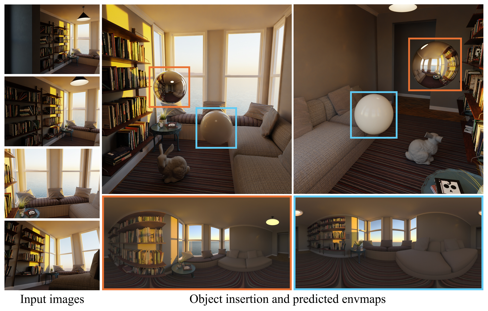

<h1 align="center">LUMEN: Geometry-Guided Diffusion Model for Spatially-Varying HDR Illumination Estimation</h1>

<p align="center">
  <b>ACM SIGGRAPH Asia 2026</b>
</p>

<p align="center">
  Hongze Chen, Fangyu Lin, Runze Zhang, Lingting Zhu, Weikai Chen, Zeyu Hu, Yingda Yin, Keyang Luo, Xin Wang, Zehong Lin, Jun Zhang
</p>

<p align="center">
  <a href=""></a>
  <a href=""></a>
  <a href="https://huggingface.co/BackRabb1t/lumen"></a>
  <a href=""></a>
  <a href="LICENSE"></a>
</p>

<p align="center">
  <a href="">Paper</a> |
  <a href="">Project Page</a> |
  <a href="https://huggingface.co/BackRabb1t/lumen">Model Weights</a> |
  <a href="">Dataset</a>
</p>

LUMEN estimates **spatially-varying HDR environment maps** from ordinary photos. Given one or more RGB images, it builds a
partial equirectangular observation of the scene and lets a FLUX-based diffusion model (fine-tuned with LoRA)
complete the full 360° panorama, which is then converted to an HDR `.exr` environment map.

<p align="center">
  
</p>

## Table of Contents
- [Installation](#installation)
- [Model Weights](#model-weights)
- [Inference](#inference)
  - [Single image](#1-single-image-inference_singlepy)
  - [Multi-view / spatially-varying lighting](#2-multi-view--spatially-varying-lighting-inference_vggtpy)
- [Citation](#citation)
- [Acknowledgements](#acknowledgements)
- [License](#license)

## Installation

The code requires an NVIDIA GPU with bfloat16 support (Ampere or newer). FLUX.1-dev runs in bf16,
so a GPU with large memory (≥ 40 GB recommended) is needed.

```bash
# --recursive also fetches VGGT (git submodule in ./vggt)
git clone --recursive https://github.com/stopaimme/lumen.git
cd lumen
# if you cloned without --recursive:
# git submodule update --init --recursive

conda create -n lumen python=3.11 -y
conda activate lumen

# 1. PyTorch (pick the wheel matching your CUDA, see https://pytorch.org)
pip install torch==2.7.0 torchvision==0.22.0 --index-url https://download.pytorch.org/whl/cu128

# 2. Python dependencies
pip install -r requirements.txt

# 3. PyTorch3D (point-cloud panorama rendering, only needed by inference_vggt.py)
pip install "git+https://github.com/facebookresearch/pytorch3d.git" --no-build-isolation
```

[VGGT](https://github.com/facebookresearch/vggt) is included as a git submodule in `vggt/` and is imported
directly from there, so it does not need to be pip-installed.

## Model Weights

Lumen uses the following models:

| Model | Usage | How to get it |
|---|---|---|
| [FLUX.1-dev](https://huggingface.co/black-forest-labs/FLUX.1-dev) | base diffusion model | download to `ckpts/flux` (below) |
| [Lumen LoRA](https://huggingface.co/BackRabb1t/lumen) | our fine-tuned LoRA | download to `ckpts/lumen` (below) |
| [FLUX.1-Redux-dev](https://huggingface.co/black-forest-labs/FLUX.1-Redux-dev) | image conditioning | downloaded automatically |
| [VGGT-1B](https://huggingface.co/facebook/VGGT-1B) | depth / intrinsics / poses | downloaded automatically |

FLUX.1-dev and FLUX.1-Redux-dev are gated models. Please first accept their licenses on the
Hugging Face model pages, then log in:

```bash
hf auth login
```

Download FLUX.1-dev (diffusers format) and the Lumen LoRA:

```bash
# FLUX.1-dev (the single-file checkpoints are not needed)
hf download black-forest-labs/FLUX.1-dev --local-dir ckpts/flux \
    --exclude "flux1-dev.safetensors" --exclude "ae.safetensors"

# Lumen LoRA
hf download BackRabb1t/lumen pytorch_lora_weights.safetensors --local-dir ckpts/lumen
```

The expected layout is:

```
ckpts/
├── flux/                       # FLUX.1-dev in diffusers format
│   ├── model_index.json
│   ├── scheduler/  tokenizer/  tokenizer_2/  transformer/  vae/  ...
└── lumen/
    └── pytorch_lora_weights.safetensors
```

Other locations can be used via `--flux_path` and `--lora_path`.

## Inference

### 1. Single image (`inference_single.py`)

Projects each input photo onto an equirectangular canvas (assuming a 60° horizontal field of view) and
completes the full panorama. Every image in `--scene_path` is processed independently.

We provide example photos in `examples/single`:

```bash
python inference_single.py --scene_path examples/single --output_path outputs/single
```

Outputs for each input `<name>.jpg`:

| File | Description |
|---|---|
| `<name>_panorama.png` | input image projected onto the panorama (the condition) |
| `<name>.exr` | predicted HDR environment map |

Main arguments:

| Argument | Default | Description |
|---|---|---|
| `--scene_path` | (required) | directory of input images (`.png/.jpg/.jpeg/.bmp/.tiff`) |
| `--output_path` | `outputs` | output directory |
| `--width` / `--height` | `1024` / `512` | panorama resolution |
| `--seed` | `42` | random seed |
| `--flux_path` / `--lora_path` | `ckpts/flux` / `ckpts/lumen` | model locations |

### 2. Multi-view / spatially-varying lighting (`inference_vggt.py`)

Takes one or more views of the same scene, jointly estimates depth, intrinsics and camera poses with VGGT,
fuses all views into a single point cloud, renders a partial panorama at each requested probe position,
and completes an HDR environment map for every position.

We provide a multi-view example (12 views) in `examples/multi_view`:

```bash
python inference_vggt.py --image_dir examples/multi_view --output_path outputs/multi_view --seed 42
```

On your own data, pass a directory of images (sorted by filename) or an explicit list of images:

```bash
# all images in a directory
python inference_vggt.py --image_dir path/to/views --output_path outputs/vggt --seed 42

# an explicit list (the first one is the reference view)
python inference_vggt.py --image_path view0.jpg view1.jpg view2.jpg --output_path outputs/vggt --seed 42
```

Only the images are used as input: camera poses and intrinsics are estimated by VGGT. The
`transform.json` in `examples/multi_view` stores the ground-truth cameras of the rendered example for reference
and is not read by the script.

**Coordinate system.** All positions are expressed in the frame of the reference (first) camera:
x points right, y points up and the camera looks along −z. Units follow VGGT's depth scale.
By default, `--num_positions` probes are placed on the segment from `--envmap_position1` to
`--envmap_position2`, i.e. 0.5 units in front of the reference camera, sweeping from left to right.

Outputs:

| File | Description |
|---|---|
| `point_cloud.ply` | fused multi-view point cloud |
| `pointrender{i}.png` | point cloud rendered at probe `i` (the condition) |
| `predict_hdr{i}.exr` | predicted HDR environment map at probe `i` |

Main arguments:

| Argument | Default | Description |
|---|---|---|
| `--image_path` | – | one or more input images, the first one is the reference view |
| `--image_dir` | – | directory of input images (appended after `--image_path`) |
| `--output_path` | `outputs_vggt` | output directory |
| `--envmap_position1` / `--envmap_position2` | `-0.3 0 -0.5` / `0.3 0 -0.5` | start / end probe position |
| `--num_positions` | `12` | number of probes between the two positions |
| `--envmap_rotation` | `-90 0 0` | panorama rotation (degrees) |
| `--redux_mode` | `first` | image condition from the reference view (`first`) or the mean over all views (`mean`) |
| `--point_radius` / `--points_per_pixel` | `0.01` / `10` | point rasterization settings |
| `--width` / `--height` | `1024` / `512` | panorama resolution |
| `--seed` | `None` | random seed (fix it for consistent results across probes) |
| `--flux_path` / `--lora_path` | `ckpts/flux` / `ckpts/lumen` | model locations |

To place a single probe at a specific location, set both positions to the same point and use
`--num_positions 1`.

**Tips.** Multi-view inputs should have the same resolution; images with different aspect ratios are padded
by VGGT and the padded regions also become points.

### HDR conversion

The diffusion model outputs an LDR panorama `L ∈ [0, 1)`, which is converted to HDR with the inverse Reinhard
operator `H = L / (1 − L)` and saved as a 32-bit float `.exr`.

## Citation

If you find this work useful, please cite:

```bibtex
@inproceedings{lumen2026,
  title     = {LUMEN: Geometry-Guided Diffusion Model for Spatially-Varying HDR Illumination Estimation},
  author    = {Hongze Chen and Fangyu Lin and Runze Zhang and Lingting Zhu and Weikai Chen and Zeyu Hu and Yingda Yin and Keyang Luo and Xin Wang and Zehong Lin and Jun Zhang},
  booktitle = {ACM SIGGRAPH Asia 2026 Conference Papers},
  year      = {2026}
}
```

## Acknowledgements

This project builds on
[FLUX](https://github.com/black-forest-labs/flux),
[diffusers](https://github.com/huggingface/diffusers),
[VGGT](https://github.com/facebookresearch/vggt),
[PyTorch3D](https://github.com/facebookresearch/pytorch3d) and
[equilib](https://github.com/haruishi43/equilib) (vendored in `external/equilib`).
We thank the authors for releasing their code and models.

Example photos in `examples/single` are from [Unsplash](https://unsplash.com).

## License

The code in this repository is released under the [Apache License 2.0](LICENSE).
`external/equilib` is from [equilib](https://github.com/haruishi43/equilib) (Apache-2.0, see `external/equilib/LICENSE`).

Third-party models and code are subject to their own licenses:
[FLUX.1-dev / FLUX.1-Redux-dev](https://huggingface.co/black-forest-labs/FLUX.1-dev/blob/main/LICENSE.md) (FLUX.1 [dev] Non-Commercial License),
[VGGT](https://github.com/facebookresearch/vggt/blob/main/LICENSE.txt) (VGGT License),
and [PyTorch3D](https://github.com/facebookresearch/pytorch3d/blob/main/LICENSE) (BSD-3-Clause).
Since the Lumen LoRA is fine-tuned from FLUX.1-dev, its use is also subject to the FLUX.1 [dev] Non-Commercial License.
